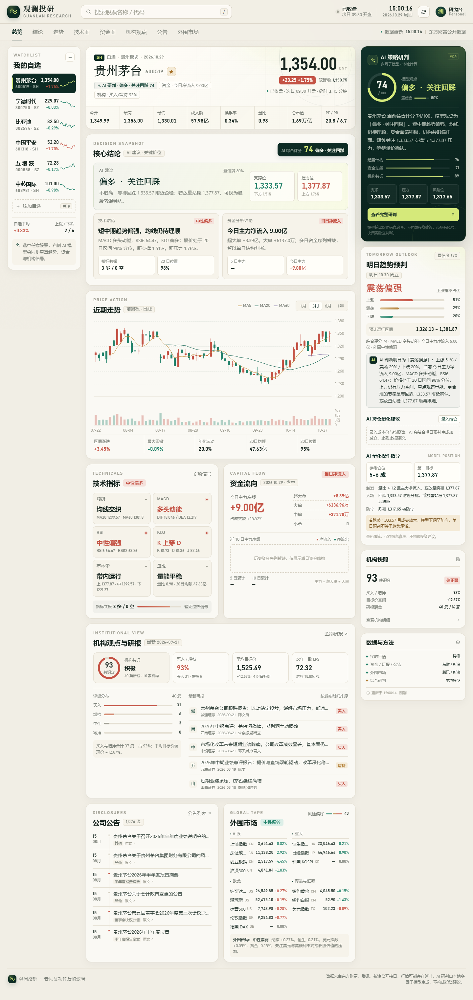
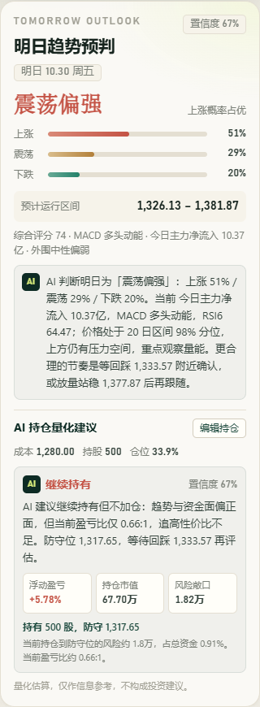

# 观澜投研 · StockLens

一页看懂一只 A 股：核心结论、近期走势、技术指标、主力资金、机构研报、公司公告、外围市场，以及一份可解释的 AI 多因子研判。全部数据来自免费公开接口，不依赖付费行情或 AI API。



## 能力清单

- **自选股**：搜索名称 / 代码 / 拼音首字母，最多 12 只自选，浏览器本地持久化。
- **核心结论**：AI 建议、支撑位、压力位、技术结论、资金分析结论，放在页面首屏下方集中展示。
- **近期走势**：前复权日 K、MA5 / MA20 / MA60、成交量，支持 1 月 / 3 月 / 6 月 / 1 年切换。
- **技术指标**：均线、MACD、RSI、KDJ、BOLL、量能六组信号，附共振强弱。
- **资金流向**：今日主力净额、超大单 / 大单 / 中单 / 小单拆解、近 10 日主力净额、5 / 10 日累计。
- **机构观点**：近一年研报聚合、买入 / 增持占比、评级分布、平均目标价、一致预期 EPS、最新研报列表。
- **公司公告**：最新公告时间线、公告分类，可跳转东方财富原文。
- **外围市场**：A 股、亚太、欧美、商品与汇率，附风险偏好评分和外围传导解读。
- **AI 研判**：本地多因子模型给出综合评分、模型观点、置信度、因子拆解、关键价位、三种情景与风险清单。
- **明日预判**：下一交易日上涨 / 震荡 / 下跌概率、预计运行区间和 AI 解读。
- **AI 持仓量化建议**：输入成本价、持股数量和可选总资金，AI 按实际持仓计算盈亏、仓位、风险敞口，并给出持有 / 加仓 / 减仓 / 止盈止损建议。
- **量化操作指导**：参考仓位、触发条件、入场方式、防守位、第一目标及风险提示；录入持仓后切换为个性化建议。
- **工程细节**：服务端聚合与缓存、上游失败自动降级、最近一次成功快照、响应式桌面 / 平板 / 手机布局。
- **字号可调**：全部字号已统一放大 4px；`public/styles.css` 顶部的 `--font-boost` 可一处继续调整全局字号。

> AI 研判是**本地可解释的多因子加权模型**，不是大语言模型自由生成，也不会调用外部 AI 接口。它把趋势、资金、机构、动量、估值、外围、量能七个维度量化后合成观点。

## 快速启动

要求：Node.js 18 或以上（项目没有第三方运行依赖）。

```powershell
cd stocklens
npm start
```

浏览器打开：

```text
http://127.0.0.1:4173
```

也可以直接双击 / 运行 `start.ps1`。需要改端口时：

```powershell
$env:PORT=8080
npm start
```

需要让局域网或外网访问时，见 [DEPLOY.md](DEPLOY.md)，包含临时隧道、Cloudflare Tunnel、Docker / 云服务器三种方案。

## 技术架构

```text
stocklens/
├─ server.js              Node 原生 HTTP 服务、数据聚合、技术指标、AI 评分
├─ public/
│  ├─ index.html          页面结构
│  ├─ styles.css          视觉系统与响应式布局
│  ├─ app.js              数据渲染、图表、自选股、搜索、交互
│  └─ vendor/echarts.min.js
├─ data/
│  ├─ snapshots/          最近一次成功数据快照（自动生成）
│  └─ desktop-1440.png    界面截图
├─ start.ps1
└─ README.md
```

- 无前端构建步骤、无 npm 依赖；ECharts 已本地化，断网也能渲染图表。
- 服务端代理上游接口，规避浏览器跨域限制，并统一字段与单位。
- 行情 25 秒缓存、日线 8 分钟、资金 2 分钟、研报 30 分钟、公告 10 分钟；手动刷新可强制更新。
- 上游异常时优先使用备用数据源；关键行情全部失败时回退到 `data/snapshots/` 的最近成功快照。

## 数据来源与降级策略

| 数据 | 主来源 | 备用来源 |
| --- | --- | --- |
| 实时行情 / 日线 | 东方财富 | 腾讯行情 |
| 资金流向 | 东方财富（日线 + 盘中） | 新浪财经（当日五档） |
| 研报 / 公告 | 东方财富 | 保留最近成功快照 |
| 外围市场 | 东方财富 | 腾讯行情 + 新浪财经 |
| 行业 / 地区 | 东方财富 F10 | 显示为 — |
| AI 研判 | 观澜本地模型 | — |

这些是公开网页接口，可能限流、变更或延时，仅适合个人研究与原型演示，不建议直接用于生产或商业用途。页脚与 AI 卡片均标注了“不构成投资建议”。

## HTTP API

| 路径 | 说明 |
| --- | --- |
| `GET /api/stock?code=600519` | 聚合个股完整分析数据，支持 `refresh=1` 强制刷新 |
| `GET /api/position-advice?code=600519&cost=1280&shares=500&capital=2000000` | 按持仓生成 AI 量化建议 |
| `GET /api/watchlist?codes=600519,300750` | 自选股报价与 24 日迷你走势 |
| `GET /api/search?q=茅台` | A 股名称 / 代码 / 拼音搜索 |
| `GET /api/health` | 健康检查、市场状态、缓存条目数 |

## AI 评分说明

七个因子按权重合成 0–100 分：

| 因子 | 权重 | 主要输入 |
| --- | --- | --- |
| 趋势结构 | 27% | 价格与 MA20 / MA60、均线排列、20 日动量 |
| 资金动能 | 22% | 近 5 日主力净额、占成交额比例、当日主力 |
| 机构共识 | 16% | 研报评级分布、覆盖数量、目标价空间 |
| 技术动量 | 15% | MACD、RSI、KDJ |
| 估值水位 | 8% | 动态 PE、PB |
| 外围环境 | 8% | 全球风险偏好评分 |
| 量能配合 | 4% | 量比、20 日均额 |

模型同时输出支撑、压力、风险位与三种情景，不输出直接买卖指令。评分阈值：≥70 偏多，60–69 中性偏多，45–59 中性观望，35–44 中性偏空，<35 偏空。

### 支撑位 / 压力位算法

支撑位与压力位不是简单取 MA20 或 20 日最高 / 最低价，而是：

1. 只把**现价下方**的 MA5/10/20/60、布林下轨/中轨、20 日低点、60 日低点、波段低点作为支撑候选；压力位只取**现价上方**的对应候选。
2. 支撑取距离现价最近且至少相隔 1% 的候选；压力同理。
3. 超出当前价 ±20% 的候选直接排除，避免深跌后把很久以前的高点当成压力位。
4. 没有合格候选时，用 ATR 波动区间生成兜底位，并再次强制支撑 < 现价 < 压力。
5. 风险位由支撑位向下按 ATR 计算，且不会高于支撑位。

这样不会出现“现价 94 元、支撑位却在 132 元”的反向区间。

### 明日趋势预判与量化指导

- 使用综合评分、MACD、KDJ、资金方向、外围风险偏好计算下一交易日**上涨 / 震荡 / 下跌**三分类概率。
- 预计运行区间以 ATR 和现价波动率为基础，限制在单日合理波动范围内。
- 量化指导给出**参考仓位、触发条件、入场方式、防守位、第一目标**，全部由评分与有效支撑/压力位生成。
- 录入持仓后，AI 会结合**成本价、持股数、总资金（可选）**计算浮动盈亏、实际仓位、风险敞口和盈亏比，输出持有 / 加仓 / 减仓 / 止盈止损建议，并给出具体减仓或加仓股数。
- 加仓建议会先检查盈亏比，盈亏比不足 1.25:1 时不会建议加仓，避免“仓位低就机械加仓”。
- 预判置信度封顶 72%，避免把单日概率估算包装成确定性结论。
- 当资金多日序列缺失时，会明确以“今日资金 + 单日结构”判断，并下调说明强度。
- 持仓数据只保存在浏览器 `localStorage`，按股票代码分别保存，不上传到第三方。
- 该模块仅作信息参考，不构成投资建议。



## 已知边界

- 仅覆盖 A 股（沪深京），暂不含港股、美股个股与基金。
- 免费行情可能延时（页面标注“延时 ≤ 15 分钟”）；盘中成交量、资金流为即时快照。
- 资金历史序列依赖东方财富接口；接口被限流时会降级为“当日资金结构”，并明确提示。
- 公告 / 研报跳转东方财富原文页；目标价来自公开研报，已过滤明显偏离现价的异常值。
- 节假日状态按周一至周五的交易时段判断，未接入交易所节假日日历。

## 免责声明

本项目仅用于技术演示与信息聚合，不构成任何投资建议、荐股或收益承诺。市场有风险，投资决策需独立判断。
